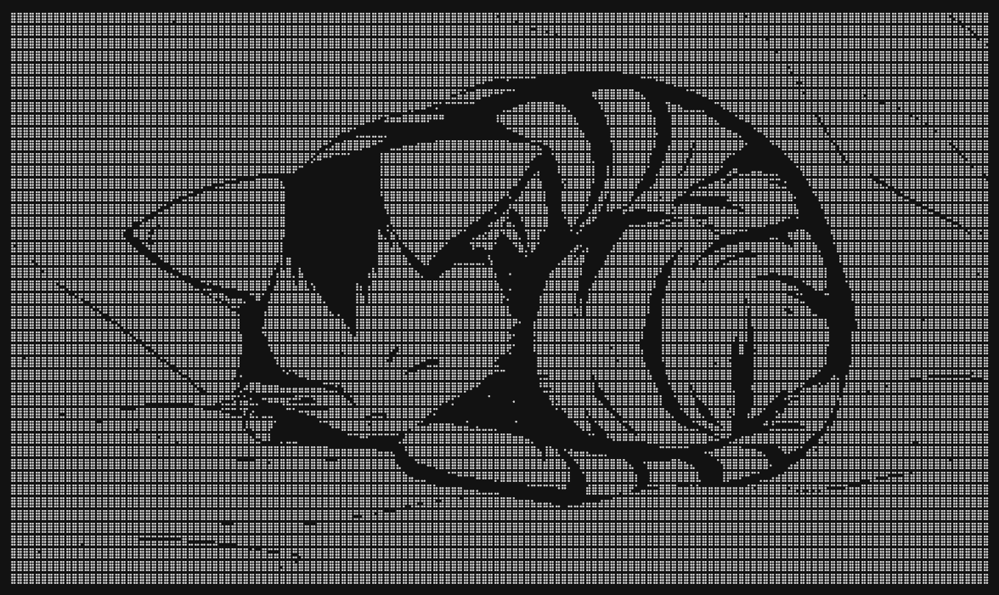

  

 

### Building things for the web. Exploring ideas. Making them real.

---

## 👋 A little about me

I'm Aditya, a developer who enjoys building digital experiences and experimenting with ideas.

I work across frontend and full-stack web development, with an interest in creating useful products and interfaces that feel good to use.

- 🌐 Building for the web
- 🧠 Interested in creative problem-solving and digital products
- 🔨 Learning by building and experimenting
- 🚀 Always have something new to explore

---

## 🧰 Technologies & Tools

### Frontend

### Backend & Tools

---

## 🚀 Selected Projects

<table>
<tr>
<td width="50%">

### 🧠 Muse

A browser-based idea-saving application.

A space to capture ideas as they come to you, without having to leave your browser.

**Built with:** HTML · CSS · JavaScript

</td>
<td width="50%">

### 🌐 The Archive

My personal portfolio and digital space.

A collection of my work, writing, experiments, sketches and things I'm currently exploring.

**Built with:** HTML · CSS · JavaScript

[↗ Visit Website](https://dapper-sprite-1431a6.netlify.app/#/)

</td>
</tr>
</table>

---

## 📊 GitHub Activity

---

### Thanks for stopping by.

*Made with curiosity, coffee, and a lot of browser tabs.*

